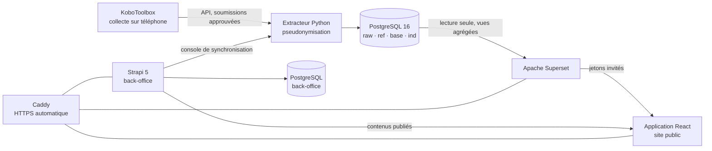

*[English version](README.md)*

# Plateforme de suivi communautaire en santé et éducation

> **Étude de cas.** Le code appartient au client et n'est pas publié ici. Cette page décrit le problème, l'architecture et les choix techniques que j'ai faits. Toutes les captures utilisent des données fictives.

**Client :** ONG de santé communautaire, Côte d'Ivoire
**Période :** octobre à décembre 2026
**Rôle :** architecte et ingénieur développeur principal (équipe de 3 : un chef de mission, un analyste de données et moi)
**Statut :** en cours, mise en ligne prévue en décembre 2026

---

## Le problème

L'ONG mène des consultations communautaires dans 48 localités : santé (VIH, couverture maladie), éducation, gouvernance locale. Les données sont collectées sur téléphone avec KoboToolbox. Il fallait :

- publier, commune par commune, des **indicateurs lisibles par le grand public**, sur téléphone et en 4G ;
- suivre les **engagements pris par les acteurs locaux**, avec un historique que personne ne puisse réécrire ;
- donner à l'équipe de l'ONG un **back-office utilisable sans développeur** ;
- protéger des **données sensibles** (statut VIH, numéros de téléphone, texte libre) dans un projet au budget serré, à livrer en trois mois, puis à transférer intégralement au client.

## Architecture

| Brique | Technologie | Rôle |
|---|---|---|
| Extraction | Python 3.12, httpx, psycopg 3 | Synchronisation planifiée depuis l'API KoboToolbox |
| Données | PostgreSQL 16 | Données brutes en JSONB, référentiels, vues d'indicateurs |
| Tableaux de bord | Apache Superset | Visualisations intégrées dans le site public |
| Back-office | Strapi 5 Community (JavaScript) | Engagements, avis du public, réglages, comptes |
| Site public | React, Vite | Pages par thème et par zone, adaptées au téléphone |
| Infrastructure | Docker Compose, Caddy, VPS 6 vCPU / 12 Go | Production et test sur un seul serveur |

Tout est libre et open source, sans licence à renouveler : condition du client, qui reprend seul l'exploitation après la livraison.

## Choix techniques notables

### 1. Protéger les données dès l'extraction

Les règles de protection ne sont pas laissées à l'interface : elles sont appliquées le plus tôt possible dans la chaîne.

- **Seules les soumissions validées** par un superviseur dans KoboToolbox entrent en base. Le filtre ne peut être désactivé qu'en développement local, et le service refuse de démarrer sinon.
- **Numéros de téléphone, photos, fichiers audio, coordonnées GPS et identifiants KoboToolbox ne quittent jamais KoboToolbox.** Le champ téléphone est exclu en dur, pas seulement par configuration : une variable d'environnement vide ne peut pas le réactiver.
- **Identifiants pseudonymisés** par HMAC-SHA256 sur l'identifiant racine de la soumission, stable même quand une réponse est corrigée.
- **Numéros saisis dans les textes libres** détectés et masqués, sans toucher aux dates, montants ou codes.
- **Aucune valeur publiée sous 5 répondants** : le masquage est fait dans les vues SQL, jamais seulement dans le front.
- **Échec sûr** : si la structure d'un formulaire ne peut pas être lue, la synchronisation de ce formulaire échoue plutôt que d'extraire des champs non vérifiés.

### 2. Un historique que même un administrateur ne peut pas réécrire

Le suivi des engagements n'a de valeur que si son historique est fiable. Une mise à jour ne peut être ni modifiée ni supprimée, et la protection est posée à chaque niveau, chacun suffisant à lui seul :

1. le service de documents de Strapi (interface, API, scripts) ;
2. les requêtes de base de Strapi (cycles de vie) ;
3. PostgreSQL, avec des déclencheurs qui refusent `UPDATE`, `DELETE` et `TRUNCATE`.

Le cas le plus subtil était le **détachement** d'une mise à jour de son engagement. Strapi supprime puis recrée les liens à chaque publication : un simple refus des suppressions aurait bloqué la publication. J'ai posé un **déclencheur de contrainte différé**, vérifié au moment du commit : chaque mise à jour doit rester rattachée à son engagement d'origine, et à lui seul.

L'état et l'avancement d'un engagement ne changent qu'en ajoutant une mise à jour, dans la même transaction. Pour corriger une erreur, on ajoute une mise à jour rectificative.

### 3. Une sécurité testée sous concurrence

- **Verrouillage des comptes atomique.** La première version lisait puis écrivait un compteur : 20 tentatives simultanées vérifiaient 20 mots de passe. La tentative est maintenant réservée par un seul `INSERT … ON CONFLICT DO UPDATE … RETURNING`, avant toute vérification du mot de passe. Résultat mesuré : 5 vérifications au plus, quelle que soit la charge.
- **Lecture publique contrôlée côté serveur.** Les filtres sont imposés après l'assainissement de la requête, et les relations renvoyées sont fixées par le serveur sur liste blanche. Un paramètre `populate` envoyé par le client ne peut plus faire apparaître un contenu masqué ; les filtres et tris sur relations, qui pouvaient servir d'oracle, sont refusés.
- **Journal d'audit en ajout seul** : connexions, modifications, modération, synchronisations.
- **Environnement de test isolé** : rôles PostgreSQL distincts, si bien que le back-office de test ne peut ni se connecter à la base de production ni y écrire.
- **Courriel** : vérification du certificat du serveur SMTP. Par défaut, la bibliothèque Python chiffre sans vérifier, ce qui exposait le mot de passe à un intermédiaire.

### 4. Sauvegardes qu'on sait restaurer

- Sauvegarde nocturne chiffrée (pg_dump et `age`, clé publique seule sur le serveur), rotation, copie hors serveur sans effet miroir : une suppression locale ne se propage pas.
- Chaque fichier est écrit sous un nom temporaire puis renommé une fois vérifié. Un essai avait montré qu'un échec pouvait remplacer une bonne sauvegarde par un fichier vide.
- Script de restauration testé de bout en bout : services arrêtés, base recréée, propriétaires et droits rétablis, fichiers téléversés restaurés, vérifications automatiques à la fin.

### 5. Déploiement simple et transférable

Un client sans développeur doit pouvoir réinstaller la plateforme. D'où :

- **Docker Compose** sur un seul serveur, avec production et test séparés par profils ;
- **Caddy** pour le HTTPS, avec des certificats Let's Encrypt obtenus et renouvelés seuls ;
- **secrets générés par script** et hook `gitleaks` qui refuse tout commit contenant un secret ;
- **site React construit dans un conteneur** : aucune dépendance à installer sur le serveur ;
- **en-têtes de sécurité** (CSP, Permissions-Policy, HSTS) sur le site public.

## Qualité

- **163 tests automatisés** : 128 pour le back-office, contre une vraie base PostgreSQL, et 35 pour l'extracteur.
- Chaque correctif de sécurité est livré avec un test qui **échouait avant** la correction.
- Revue de code complète à mi-parcours : 8 correctifs identifiés, dont 3 failles, tous corrigés et testés avant le premier déploiement.

## Méthode

J'ai conçu l'architecture et rédigé les spécifications. Le code a été produit avec un assistant de programmation (Claude Code), dans un cadre strict :

- des **briefs écrits** par lot de tâches, avec des critères de fin vérifiables et des règles non négociables (protection des données, historique en ajout seul) ;
- des **points d'arrêt** à chaque lot, avec le diff, les tests et les écarts justifiés ;
- une **revue humaine** de chaque lot avant fusion, et aucune action sur le serveur ni aucun accès aux secrets par l'assistant.

Cette organisation a permis de livrer en avance le back-office et l'extraction, avec une couverture de tests qu'un projet de cette taille n'a généralement pas.

## Ce que je retiens

- **Placer chaque règle de protection au plus bas niveau possible** (base de données, extraction) plutôt que dans l'interface.
- **Tester la concurrence et les pannes, pas seulement les cas nominaux** : les deux défauts les plus sérieux trouvés (verrouillage contournable, sauvegarde écrasée par un fichier vide) n'apparaissaient qu'ainsi.
- **Concevoir pour le transfert dès le premier jour** : comptes au nom du client, outils libres, procédures écrites et testées.

## Captures

<!-- Ajouter ici les captures avec données fictives, une fois l'accord du client obtenu pour l'usage de son identité visuelle. -->

| Site public | Back-office |
|---|---|
|  |  |
|  |  |

---

**Pascal Komena** · Ingénieur full-stack et spécialiste des systèmes d'information de santé (OpenELIS, OpenMRS, interopérabilité FHIR) · Abidjan
