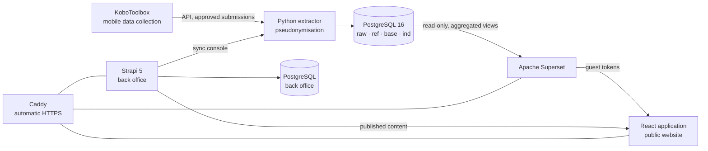

*[Version française](README.fr.md)*

# Community monitoring platform for health and education

> **Case study.** The source code belongs to the client and is not published here. This page describes the problem, the architecture and the technical decisions I made. All screenshots use fictitious data.

**Client:** community health NGO, Côte d'Ivoire
**Period:** October to December 2026
**Role:** architect and lead software engineer (team of 3: a project lead, a data analyst and myself)
**Status:** in progress, go-live planned for December 2026

---

## The problem

The NGO runs community consultations in 48 localities, covering health (HIV, health insurance coverage), education and local governance. Data is collected on mobile phones with KoboToolbox. The project had to:

- publish **indicators the general public can read**, municipality by municipality, on a phone over a 4G connection;
- track **commitments made by local stakeholders**, with a history nobody can rewrite;
- give the NGO's staff a **back office they can run without a developer**;
- protect **sensitive data** (HIV status, phone numbers, free text) on a tight budget, with three months to deliver, followed by a full handover to the client.

## Architecture

| Component | Technology | Role |
|---|---|---|
| Extraction | Python 3.12, httpx, psycopg 3 | Scheduled sync from the KoboToolbox API |
| Data | PostgreSQL 16 | Raw data as JSONB, reference tables, indicator views |
| Dashboards | Apache Superset | Visualisations embedded in the public website |
| Back office | Strapi 5 Community (JavaScript) | Commitments, public feedback, settings, accounts |
| Public website | React, Vite | Pages by theme and by area, mobile first |
| Infrastructure | Docker Compose, Caddy, VPS 6 vCPU / 12 GB | Production and test on a single server |

Everything is free and open source, with no licence to renew: a requirement from the client, who runs the platform alone after handover.

## Key technical decisions

### 1. Protect the data at extraction time

Data protection rules are not left to the user interface: they are enforced as early as possible in the pipeline.

- **Only submissions approved** by a supervisor in KoboToolbox reach the database. The filter can only be turned off in local development; otherwise the service refuses to start.
- **Phone numbers, photos, audio files, GPS coordinates and KoboToolbox identifiers never leave KoboToolbox.** The phone number field is excluded in code, not just through configuration: an empty environment variable cannot bring it back.
- **Identifiers are pseudonymised** with HMAC-SHA256 on the submission's root identifier, which stays stable when an answer is corrected.
- **Phone numbers typed into free text** are detected and masked, without touching dates, amounts or codes.
- **No value is published below 5 respondents.** Masking happens in the SQL views, never only in the front end.
- **Fail closed.** If a form's structure cannot be read, syncing that form fails rather than extracting fields that were not checked.

### 2. A history that not even an administrator can rewrite

Tracking commitments is only worth something if the history can be trusted. An update can be neither edited nor deleted, and the rule is enforced at every layer, each one sufficient on its own:

1. Strapi's document service (admin UI, API, scripts);
2. Strapi's database queries (lifecycle hooks);
3. PostgreSQL, with triggers that reject `UPDATE`, `DELETE` and `TRUNCATE`.

The trickiest case was **detaching** an update from its commitment. Strapi deletes and recreates relation links every time an entry is published, so simply rejecting deletes would have broken publishing. I used a **deferred constraint trigger**, checked at commit time: every update must remain linked to its original commitment, and to that commitment only.

A commitment's status and progress only change by adding an update, in the same transaction. Mistakes are fixed by adding a corrective update.

### 3. Security tested under concurrency

- **Atomic account lockout.** The first version read a counter, then wrote it back: 20 simultaneous attempts checked 20 passwords. Each attempt is now reserved by a single `INSERT … ON CONFLICT DO UPDATE … RETURNING`, before the password is checked. Measured result: at most 5 password checks, whatever the load.
- **Server-side control of public reads.** Filters are enforced after the query is sanitised, and the relations returned are set by the server from an allow list. A `populate` parameter sent by the client can no longer expose hidden content, and filters or sorts on relations, which could act as an oracle, are rejected.
- **Append-only audit log** covering logins, edits, moderation and syncs.
- **Isolated test environment.** Separate PostgreSQL roles mean the test back office can neither connect to nor write to the production database.
- **Email.** The SMTP server certificate is verified. By default, Python's mail library encrypts without verifying, which exposed the password to anyone in the middle.

### 4. Backups that can actually be restored

- Nightly encrypted backups (pg_dump and `age`, with only the public key on the server), with rotation and an off-site copy that is not a mirror: a local deletion does not propagate.
- Each file is written under a temporary name and renamed once verified. A test had shown that a failure could replace a good backup with an empty file.
- The restore script is tested end to end: services stopped, database recreated, owners and grants restored, uploaded files restored, automatic checks at the end.

### 5. Simple, transferable deployment

A client without a developer must be able to reinstall the platform. Hence:

- **Docker Compose** on a single server, with production and test separated by profiles;
- **Caddy** for HTTPS, with Let's Encrypt certificates issued and renewed automatically;
- **secrets generated by script**, and a `gitleaks` hook that rejects any commit containing a secret;
- **the React site built inside a container**, so nothing has to be installed on the server;
- **security headers** (CSP, Permissions-Policy, HSTS) on the public website.

## Quality

- **163 automated tests**: 128 for the back office, run against a real PostgreSQL database, and 35 for the extractor.
- Every security fix ships with a test that **failed before** the fix.
- A full mid-project code review found 8 issues, including 3 security flaws. All were fixed and tested before the first deployment.

## Method

I designed the architecture and wrote the specifications. The code was produced with an AI coding assistant (Claude Code), within a strict framework:

- **written briefs** for each batch of tasks, with verifiable acceptance criteria and non-negotiable rules (data protection, append-only history);
- **checkpoints** after each batch, with the diff, the tests and justified deviations;
- **human review** of every batch before merging. The assistant never acted on the server and never had access to secrets.

This setup delivered the back office and the data extraction ahead of plan, with a level of test coverage that projects of this size rarely reach.

## Takeaways

- **Enforce each protection rule at the lowest possible layer** (database, extraction) rather than in the user interface.
- **Test concurrency and failures, not just the happy path.** The two most serious defects found (a lockout that could be bypassed, a backup overwritten by an empty file) only showed up that way.
- **Design for handover from day one**: accounts in the client's name, open-source tools, written and tested procedures.

## Screenshots

<!-- Add screenshots with fictitious data here, once the client has approved the use of its visual identity. -->

| Public website | Back office |
|---|---|
|  |  |
|  |  |

---

**Pascal Komena** · Full-stack engineer and health information systems specialist (OpenELIS, OpenMRS, FHIR interoperability) · Abidjan, Côte d'Ivoire
